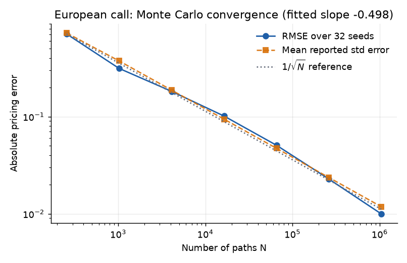
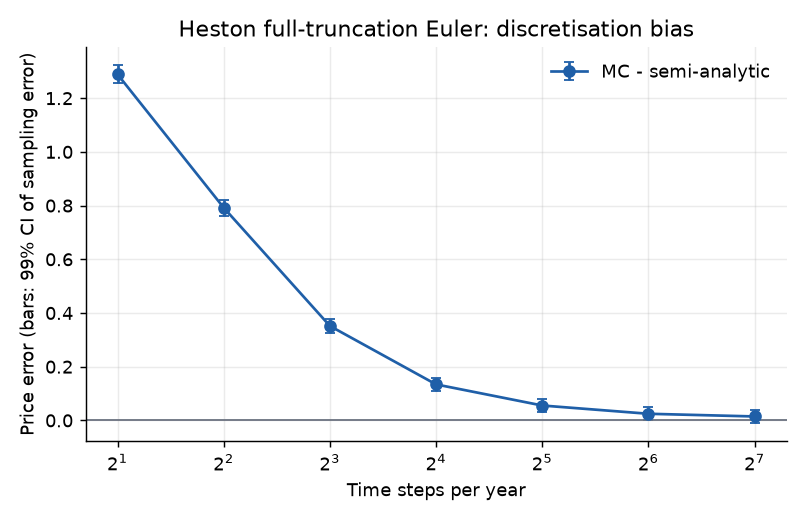
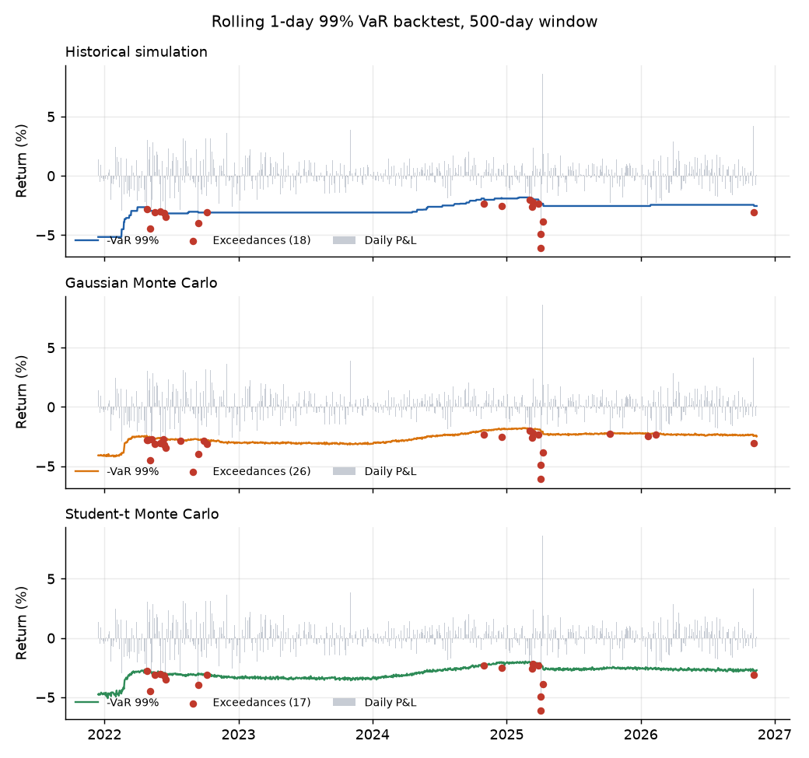

# mc-risk

[](https://github.com/Nicholas-lkn/mc-risk/actions/workflows/ci.yml)

A Monte Carlo option pricing and portfolio risk engine in Python. It prices European, Asian,
barrier and American options under GBM, Heston and Merton models, estimates Greeks three ways,
and computes 1-day VaR and CVaR in CAD for a Canadian and US equity portfolio with backtests and
stress scenarios. The focus is on correctness: every Monte Carlo number is checked against a
closed form, a semi-analytic price or a lattice, and the checks are written up in a validation
report that is generated by code.

## Results highlights

<!-- RESULTS:START -->
Generated by `scripts/validate.py`: **68 checks passed, 0 failed**. Full tables in [docs/validation.md](docs/validation.md).

| Component | Checked against | Error | Std error | Result |
|---|---|---|---|---|
| European call/put (GBM) | Black-Scholes | +0.01543 | 0.01909 | 8/8 |
| Variance reduction (European call) | Black-Scholes | -0.00011 | 0.000286 | Sobol VRF 6,789x |
| Geometric Asian call (arithmetic priced by control variate) | Discrete geometric closed form | -0.01841 | 0.01647 | PASS, CV VRF 1,389x |
| Down-and-out call (m=52) | Closed form + BGK | +0.00177 | 0.02139 | PASS |
| American put (LSM, S0=36) | CRR tree, 2,000 steps | +0.0049 | 0.0066 | PASS |
| European (Heston, 200 steps) | Semi-analytic (CF) | +0.02423 | 0.01836 | 6/6 |
| European (Merton jumps) | Merton series | -0.00136 | 0.01991 | 6/6 |
| Delta and vega, 3 estimators | Black-Scholes Greeks | +0.00142 | 0.00093 | 6/6 |
| Portfolio VaR, real data | Closed-form normal / Student-t VaR | -0.01% (Gaussian MC) | n/a | hist. backtest 18 exceedances vs 12.6 expected |

1-day 99% VaR and CVaR, CAD 1,000,000 portfolio, latest 500 days of real data to 2026-11-13:

| Method | VaR | CVaR | VaR (CAD) | CVaR (CAD) | Backtest exceedances | Kupiec p |
|---|---|---|---|---|---|---|
| Historical simulation | 2.54% | 4.11% | 25,449 | 41,121 | 18 of 1260 (expected 12.6) | 0.151 |
| Gaussian Monte Carlo | 2.44% | 2.81% | 24,374 | 28,058 | 26 of 1260 (expected 12.6) | 0.001 |
| Student-t Monte Carlo | 2.76% | 3.76% | 27,592 | 37,571 | 17 of 1260 (expected 12.6) | 0.237 |
<!-- RESULTS:END -->

| Monte Carlo convergence | Heston discretisation bias |
|---|---|
|  |  |



What the results say, briefly:

- Plain Monte Carlo converges at the expected `1/sqrt(N)` rate. Randomised Sobol with a Brownian
  bridge cuts variance by three to four orders of magnitude on smooth payoffs, and the geometric
  control variate does the same for the arithmetic Asian.
- The continuous barrier formula is wrong for a discretely monitored barrier by many standard
  errors, even with daily monitoring. The Broadie-Glasserman-Kou shift fixes it.
- A Heston confidence interval can be tight around a biased number: the Euler bias is visible
  below about 64 steps per year in the hard case.
- On real data the Gaussian VaR model is rejected by the Kupiec test (about twice the expected
  exceedances), while historical simulation and the fitted Student-t model are not rejected.

## Quick start

```bash
git clone https://github.com/Nicholas-lkn/mc-risk.git
cd mc-risk
uv sync --all-extras          # Python 3.12; extras: app, fast (Numba), data, notebooks

uv run pytest                 # 112 tests, about 25 seconds
uv run ruff check .

# Real market data for the risk layer (not committed, see Design choices)
uv run python scripts/download_data.py

# Rebuild every plot, docs/validation.md and the results block above (about 75 seconds)
uv run python scripts/validate.py

# Streamlit app
uv run streamlit run src/mc_risk/app/streamlit_app.py
```

```python
from mc_risk import price_european, price_asian
from mc_risk.analytic import bs_price

res = price_european(100, 105, r=0.03, sigma=0.2, t=1.0, method="sobol", n_paths=2**16, seed=0)
print(res.price, res.std_error, res.ci99, res.contains(bs_price(100, 105, 0.03, 0.2, 1.0)))

asian = price_asian(100, 100, r=0.03, sigma=0.2, t=1.0, n_steps=50)  # geometric control variate
```

Every pricer returns a frozen `PriceResult(price, std_error, ci99, n_paths, runtime, method)`.

## Project structure

```
src/mc_risk/
  result.py        PriceResult dataclass
  engine.py        mc_price: plain, antithetic, randomised Sobol, control variates
  exotics.py       Asian, down-and-out barrier, American (Longstaff-Schwartz)
  pricers.py       European options under Heston and Merton
  fast.py          optional Numba kernels
  models/          GBM (exact, Brownian bridge), Heston (full-truncation Euler), Merton
  payoffs/         payoff functions on path arrays
  analytic/        Black-Scholes, geometric Asian, barrier + BGK, CRR tree, Heston CF, Merton series
  greeks/          delta and vega: pathwise, likelihood ratio, finite differences
  risk/            data, VaR/CVaR models, backtests, stress scenarios
  app/             Streamlit app and its UI-free pricing dispatch
scripts/           validate.py (all checks, plots, report), download_data.py
tests/             one file per layer, fixed seeds
docs/              validation.md (generated), notes/ (one math note per layer), img/
notebooks/         01_pricing, 02_greeks, 03_risk (executed, outputs included)
```

Documentation: [validation report](docs/validation.md) and math notes on
[Monte Carlo](docs/notes/01_gbm_monte_carlo.md),
[variance reduction](docs/notes/02_variance_reduction.md),
[exotics](docs/notes/03_exotics.md),
[Heston and Merton](docs/notes/04_heston_merton.md),
[Greeks](docs/notes/05_greeks.md) and
[portfolio risk](docs/notes/06_portfolio_risk.md).

## Design choices

- **Acceptance rule.** A Monte Carlo price passes if its reference lies inside the 99% confidence
  interval. Seeds are fixed, so tests are deterministic. With roughly 100 seeded interval checks
  a few misses are expected by chance. Two test seeds were changed for that reason (Heston calls
  at 2.6 standard errors, a Heston put at 2.6); in both cases a 300-seed or 1,000,000-path rerun
  showed an unbiased estimator with normal coverage, and the reason is recorded next to the test.
  One Sobol test had its path count raised from 2^15 to 2^17 after a miss with small scrambles.
  No seed in `scripts/validate.py` was changed.
- **RQMC error bars.** Sobol error is estimated from 64 independent scrambles with a t interval.
  With 16 scrambles the nominal 99% interval covered the true price only about 95% of the time
  in this project's own measurements, so the default is 64.
- **Asian control variate.** The control is the geometric Asian on the same discrete fixing dates,
  whose closed form is exact on the simulated grid. Kemna-Vorst (continuous) is implemented and
  shown as its limit, but using it as the control mean would bias the price.
- **American reference.** Longstaff-Schwartz with 50 exercise dates prices a Bermudan option, so
  it is compared with a 2,000-step CRR tree restricted to the same 50 dates. The fully American
  tree value is reported next to it.
- **Heston reference.** Characteristic function in the Albrecher et al. form, adaptive quadrature
  truncated at u = 250 (insensitive to the cut-off to 1e-9).
- **Greeks** reuse `PriceResult`; the `price` field holds the Greek.
- **Risk data.** Yahoo adjusted closes are not committed (redistribution terms, and adjusted
  prices change over time). `scripts/download_data.py` fetches them one ticker at a time and
  fails loudly if a symbol comes back empty. Tests and CI use a synthetic generator; the
  validation report states which source it was built on.
- **Calendar.** Toronto and New York holidays differ. Days with no equity trading are dropped;
  a single closed market is forward-filled (zero return that day).
- **Portfolio.** CAD 1,000,000 with constant weights: RY.TO 15%, TD.TO 15%, SHOP.TO 10%,
  ENB.TO 10%, AAPL 20%, MSFT 20%, JPM 10%. US names are converted to CAD before returns are
  computed, so currency risk is inside each position's return. XIU.TO and SPY (in CAD) are
  reported as benchmarks.
- **Student-t fit.** Mean and covariance are fixed at sample values and the degrees of freedom
  are fitted by maximum likelihood. In the backtest they are refitted every 21 days.
- **Backtest.** 500-day window, 20,000 scenarios per day for the Monte Carlo models. Backtest
  rejections are reported as findings about the models and are not counted as failed checks.
- **Stress scenarios.** COVID crash replay, 2022 sell-off replay, CAD -10% and +10%, and a
  combined equity and currency shock. CAD -10% is a gain for this portfolio, so the opposite
  move is shown as the currency loss scenario.
- **Numba** is an optional extra. Kernels are parallel and reseed per chunk of 1,024 paths, so
  results do not depend on the thread count. The measured gain is modest because NumPy's random
  number generation already dominates the runtime.
- **CI** runs ruff and pytest. It does not run `scripts/validate.py`, which needs market data.

## Limitations

- Model parameters are illustrative. Nothing is calibrated to market option prices.
- Heston uses full-truncation Euler, which is biased at coarse time steps and slow when the
  Feller condition fails. Quadratic-exponential or exact schemes are not implemented.
- The barrier closed form covers the down-and-out call with barrier at or below the strike.
  Other barrier types can be simulated but have no reference here.
- Longstaff-Schwartz values and fits on the same paths, with a polynomial basis in one dimension.
  There is no out-of-sample pass and no dual upper bound.
- Greeks cover delta and vega of terminal payoffs under GBM. No gamma, no path-dependent Greeks.
- The risk portfolio is linear (stocks only). The VaR models are unconditional: no GARCH or EWMA
  volatility filtering, so they adapt slowly to regime changes. The backtest has about 12.6
  expected exceedances, which gives the coverage tests limited power.
- Toronto and New York closing prices are treated as simultaneous.
- Runtimes in the report come from a 2-core machine and will differ elsewhere.
