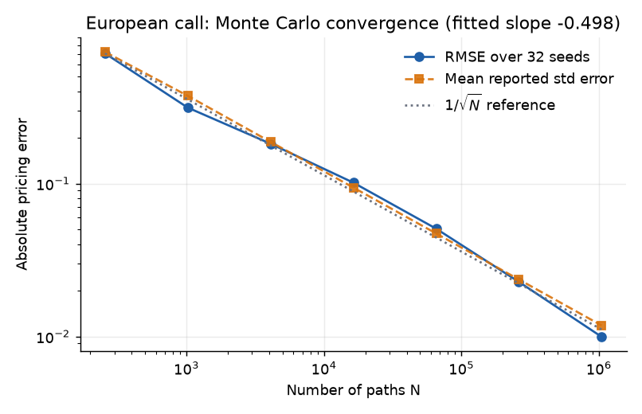

# Validation report

Generated by `scripts/validate.py`. Do not edit by hand. Python 3.12.3, NumPy 2.5.5, SciPy 1.18.1.

Acceptance rule for prices: the reference value must lie inside the 99% confidence interval of the Monte Carlo estimate. All seeds are fixed, so the report is reproducible up to the runtime columns. With this many independent checks at the 99% level an occasional miss would be expected by chance; the seeds here are fixed and were not tuned per case.

**Result: 37 checks passed, 0 failed.**

## 1. GBM paths and European options

Checked against: Black-Scholes-Merton closed form. Base case S0=100, r=0.03, q=0.01, sigma=0.2, T=1. 400,000 paths, plain Monte Carlo, seed 0.

| Case | Reference | MC price | Error | Std error | 99% CI | Error / SE |  |
|---|---|---|---|---|---|---|---|
| call K=80 | 22.31855 | 22.33119 | +0.01264 | 0.02949 | [22.25523, 22.40714] | +0.43 | PASS |
| call K=100 | 8.82732 | 8.84512 | +0.01780 | 0.02160 | [8.78947, 8.90077] | +0.82 | PASS |
| call K=105 | 6.63806 | 6.65350 | +0.01543 | 0.01909 | [6.60432, 6.70268] | +0.81 | PASS |
| call K=120 | 2.52158 | 2.52322 | +0.00163 | 0.01205 | [2.49219, 2.55425] | +0.14 | PASS |
| put K=80 | 0.94921 | 0.95388 | +0.00468 | 0.00509 | [0.94076, 0.96701] | +0.92 | PASS |
| put K=100 | 6.86689 | 6.87673 | +0.00984 | 0.01521 | [6.83756, 6.91590] | +0.65 | PASS |
| put K=105 | 9.52986 | 9.53733 | +0.00747 | 0.01790 | [9.49124, 9.58343] | +0.42 | PASS |
| put K=120 | 19.97006 | 19.96374 | -0.00633 | 0.02460 | [19.90038, 20.02710] | -0.26 | PASS |

Convergence of the base-case call (K=105) against the number of paths:

| Check | Value | Expected |  |
|---|---|---|---|
| Log-log slope of RMSE vs N | -0.498 | -0.5 +/- 0.05 | PASS |
| RMSE / reported std error at N=1,048,576 | 0.84 | about 1 (0.7 to 1.4) | PASS |

Limitations: GBM assumes constant volatility and no jumps. The log-Euler scheme is exact for GBM, so the only error here is sampling error.

## 2. Variance reduction

Checked against: Black-Scholes price of the base-case call (K=105). Budget 262,144 path evaluations per method, seed 0. Variance reduction factor (VRF) is the variance of plain Monte Carlo over the variance of the method at equal budget. Efficiency also accounts for runtime: VRF x (plain runtime / method runtime).

| Method | Price | Error | Std error | VRF | Runtime (ms) | Efficiency | In 99% CI |
|---|---|---|---|---|---|---|---|
| Plain | 6.65259 | +0.01453 | 0.023600 | 1.0 | 7.1 | 1.0 | PASS |
| Antithetic | 6.64941 | +0.01135 | 0.019757 | 1.4 | 4.9 | 2.1 | PASS |
| Control variate (underlying) | 6.64500 | +0.00694 | 0.011816 | 4.0 | 10.6 | 2.7 | PASS |
| Scrambled Sobol, 64 scrambles (RQMC) | 6.63795 | -0.00011 | 0.000286 | 6,788.6 | 32.6 | 1,474.3 | PASS |

| Check | Value | Expected |  |
|---|---|---|---|
| VRF of Antithetic | 1.4 | > 1 | PASS |
| VRF of Control variate (underlying) | 4.0 | > 1 | PASS |
| VRF of Scrambled Sobol, 64 scrambles (RQMC) | 6,788.6 | > 1 | PASS |

Effect of the Brownian bridge. The same call is priced on a 64-step path, so the Sobol points are 64-dimensional. With the bridge, the first coordinate alone fixes the terminal value; with incremental construction the payoff depends on all 64.

| Construction | Price | Std error | VRF vs plain | In 99% CI |
|---|---|---|---|---|
| Plain MC | 6.62918 | 0.046985 | 1.0 | PASS |
| Sobol, incremental | 6.63333 | 0.013742 | 11.7 | PASS |
| Sobol, Brownian bridge | 6.63886 | 0.001197 | 1,540.0 | PASS |

Coverage of the RQMC confidence interval. The scramble means are not exactly normal, so the t interval built from a few scrambles can be too narrow. The table shows the share of 200 independent replications (seeds 0 to 199, 65,536 points each) whose 99% CI contains the Black-Scholes price. This is why the default is 64 scrambles, not 16.

| Scrambles | Empirical coverage of 99% CI | Expected |  |
|---|---|---|---|
| 16 | 0.945 | reported only |  |
| 32 | 0.960 | reported only |  |
| 64 | 0.990 | >= 0.97 | PASS |

Limitations: the RQMC standard error comes from a limited number of scramble means and is itself noisy; coverage with few scrambles is below nominal (table above). The control variate coefficient is estimated from the same sample, which introduces an O(1/N) bias. Antithetic sampling helps monotone payoffs and can do nothing, or harm, for symmetric ones such as straddles. Runtimes are single runs on the machine that built the report.

## 3. Exotics: Asian, barrier, American

### 3.1 Asian options

Checked against: closed form for the discretely monitored geometric Asian (50 fixings), which is exact on the simulated grid. The Kemna-Vorst continuous formula is its limit and is shown for reference. S0=K=100, 200,000 paths.

| Case | Reference | MC price | Error | Std error | 99% CI | Error / SE |  |
|---|---|---|---|---|---|---|---|
| geometric call | 4.89268 | 4.87426 | -0.01841 | 0.01647 | [4.83184, 4.91669] | -1.12 | PASS |
| geometric put | 4.22388 | 4.23037 | +0.00649 | 0.01343 | [4.19579, 4.26495] | +0.48 | PASS |

Kemna-Vorst continuous call: 4.81493; discrete call with 50 fixings: 4.89268. The gap is the effect of discrete monitoring, not an error.

The arithmetic Asian has no closed form. It is priced with the geometric Asian as control variate; the check is that the independent plain estimate agrees.

| Arithmetic call | Price | Std error | 99% CI | Paths | VRF | Runtime (ms) |
|---|---|---|---|---|---|---|
| Plain | 5.05935 | 0.017016 | [5.01552, 5.10318] | 200,000 | 1 | 239 |
| Geometric control variate | 5.07879 | 0.000457 | [5.07762, 5.07997] | 200,000 | 1,389 | 277 |
| Sobol + bridge + control variate | 5.07867 | 0.000123 | [5.07834, 5.07899] | 131,072 | 29,134 | 452 |

| Check | Value | Expected |  |
|---|---|---|---|
| Plain CI contains the control-variate price | 5.07879 in [5.01552, 5.10318] | yes | PASS |
| Control-variate VRF | 1,389 | > 100 | PASS |
| Arithmetic price above geometric price (AM-GM) | 5.07879 > 4.89268 | yes | PASS |

### 3.2 Down-and-out barrier call

Checked against: Reiner-Rubinstein closed form for continuous monitoring, with the Broadie-Glasserman-Kou (BGK) barrier shift H exp(-0.5826 sigma sqrt(T/m)) for m monitoring dates. S0=K=100, H=90. Continuous-monitoring price: 7.22781. 400,000 paths.

| Monitoring dates m | MC price | Std error | MC - continuous formula | BGK-corrected formula | MC - BGK | Error / SE | In 99% CI |
|---|---|---|---|---|---|---|---|
| 12 | 8.02633 | 0.02150 | +0.79852 | 8.03663 | -0.01031 | -0.48 | PASS |
| 52 | 7.67694 | 0.02139 | +0.44913 | 7.67517 | +0.00177 | +0.08 | PASS |
| 252 | 7.43999 | 0.02129 | +0.21219 | 7.44603 | -0.00603 | -0.28 | PASS |

The uncorrected continuous formula is biased low by many standard errors even with daily monitoring; the BGK shift removes the bias. Limitations: the correction is asymptotic in m and degrades when the barrier is very close to the spot or m is small. Only the down-and-out call with H <= K has a reference here.

### 3.3 American put (Longstaff-Schwartz)

Checked against: CRR binomial tree with 2,000 steps. LSM with 50 exercise dates prices a Bermudan option, so the like-for-like reference is the tree with exercise allowed at the same 50 dates. The fully American tree value is shown as well. K=40, r=0.06, T=1 (cases from Longstaff and Schwartz, 2001, Table 1). 200,000 paths, cubic polynomial, in-the-money paths only.

| Case | European (BS) | CRR American | CRR Bermudan-50 | LSM | LSM - Bermudan | Std error | In 99% CI | LSM > European |
|---|---|---|---|---|---|---|---|---|
| S0=36, sigma=0.2 | 3.8443 | 4.4867 | 4.4780 | 4.4830 | +0.0049 | 0.0066 | PASS | PASS |
| S0=36, sigma=0.4 | 6.7114 | 7.1090 | 7.1014 | 7.1084 | +0.0071 | 0.0135 | PASS | PASS |
| S0=40, sigma=0.2 | 2.0664 | 2.3194 | 2.3140 | 2.3179 | +0.0039 | 0.0062 | PASS | PASS |
| S0=44, sigma=0.2 | 1.0169 | 1.1132 | 1.1101 | 1.1102 | +0.0001 | 0.0046 | PASS | PASS |

Limitations: LSM has two opposing biases. The fitted exercise rule is suboptimal (low bias), and the same paths are used to fit and to value (high bias, small at this path count). The standard error ignores the dependence created by the shared regression. A separate out-of-sample valuation pass would give a clean lower bound. Polynomials in S/K are adequate for one underlying; they do not scale to baskets.

