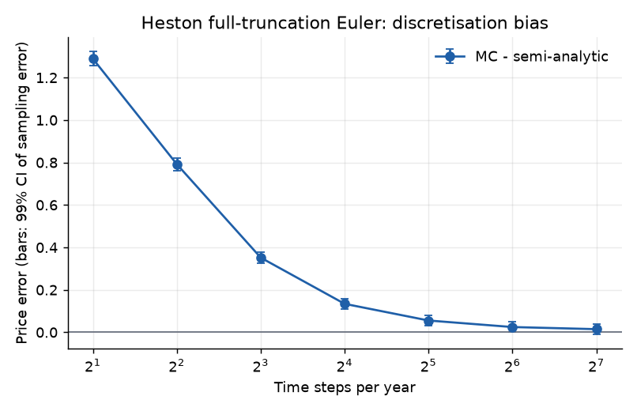
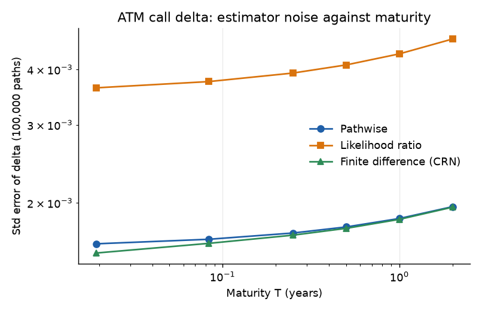
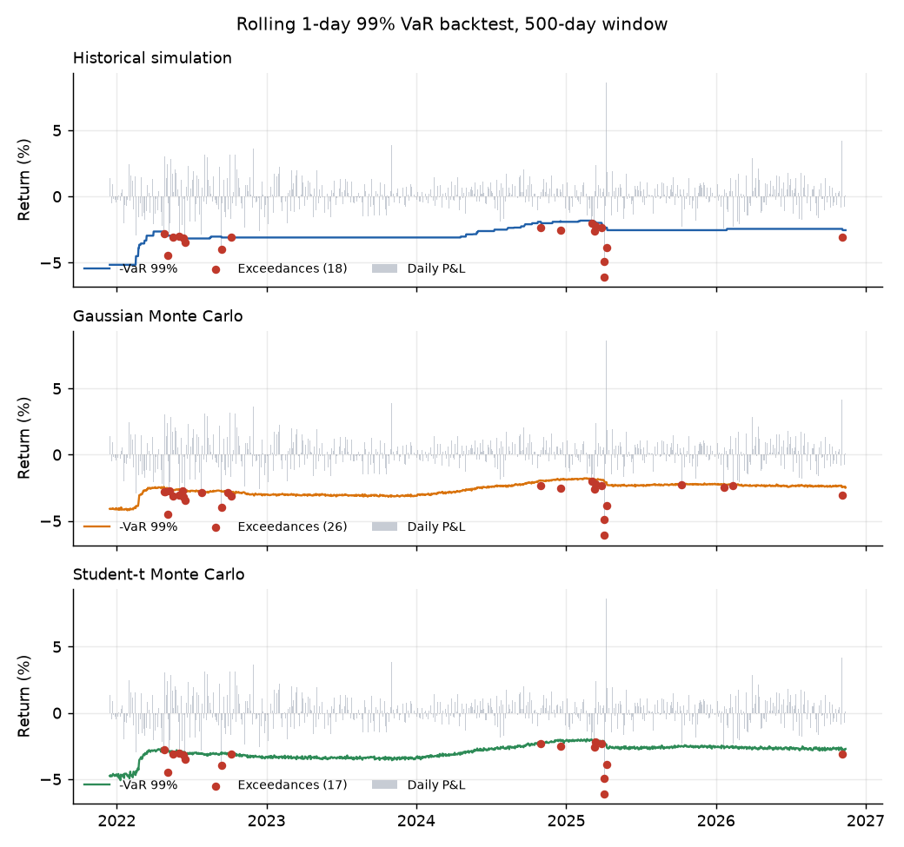

# Validation report

Generated by `scripts/validate.py`. Do not edit by hand. Python 3.12.3, NumPy 2.5.5, SciPy 1.18.1.

Acceptance rule for prices: the reference value must lie inside the 99% confidence interval of the Monte Carlo estimate. All seeds are fixed, so the report is reproducible up to the runtime columns. With this many independent checks at the 99% level an occasional miss would be expected by chance; the seeds here are fixed and were not tuned per case.

**Result: 66 checks passed, 0 failed.**

## 1. GBM paths and European options

Checked against: Black-Scholes-Merton closed form. Base case S0=100, r=0.03, q=0.01, sigma=0.2, T=1. 400,000 paths, plain Monte Carlo, seed 0.

| Case | Reference | MC price | Error | Std error | 99% CI | Error / SE |  |
|---|---|---|---|---|---|---|---|
| call K=80 | 22.31855 | 22.33119 | +0.01264 | 0.02949 | [22.25523, 22.40714] | +0.43 | PASS |
| call K=100 | 8.82732 | 8.84512 | +0.01780 | 0.02160 | [8.78947, 8.90077] | +0.82 | PASS |
| call K=105 | 6.63806 | 6.65350 | +0.01543 | 0.01909 | [6.60432, 6.70268] | +0.81 | PASS |
| call K=120 | 2.52158 | 2.52322 | +0.00163 | 0.01205 | [2.49219, 2.55425] | +0.14 | PASS |
| put K=80 | 0.94921 | 0.95388 | +0.00468 | 0.00509 | [0.94076, 0.96701] | +0.92 | PASS |
| put K=100 | 6.86689 | 6.87673 | +0.00984 | 0.01521 | [6.83756, 6.91590] | +0.65 | PASS |
| put K=105 | 9.52986 | 9.53733 | +0.00747 | 0.01790 | [9.49124, 9.58343] | +0.42 | PASS |
| put K=120 | 19.97006 | 19.96374 | -0.00633 | 0.02460 | [19.90038, 20.02710] | -0.26 | PASS |

Convergence of the base-case call (K=105) against the number of paths:

| Check | Value | Expected |  |
|---|---|---|---|
| Log-log slope of RMSE vs N | -0.498 | -0.5 +/- 0.05 | PASS |
| RMSE / reported std error at N=1,048,576 | 0.84 | about 1 (0.7 to 1.4) | PASS |

Limitations: GBM assumes constant volatility and no jumps. The log-Euler scheme is exact for GBM, so the only error here is sampling error.

## 2. Variance reduction

Checked against: Black-Scholes price of the base-case call (K=105). Budget 262,144 path evaluations per method, seed 0. Variance reduction factor (VRF) is the variance of plain Monte Carlo over the variance of the method at equal budget. Efficiency also accounts for runtime: VRF x (plain runtime / method runtime).

| Method | Price | Error | Std error | VRF | Runtime (ms) | Efficiency | In 99% CI |
|---|---|---|---|---|---|---|---|
| Plain | 6.65259 | +0.01453 | 0.023600 | 1.0 | 7.1 | 1.0 | PASS |
| Antithetic | 6.64941 | +0.01135 | 0.019757 | 1.4 | 4.7 | 2.2 | PASS |
| Control variate (underlying) | 6.64500 | +0.00694 | 0.011816 | 4.0 | 10.2 | 2.8 | PASS |
| Scrambled Sobol, 64 scrambles (RQMC) | 6.63795 | -0.00011 | 0.000286 | 6,788.6 | 34.4 | 1,407.7 | PASS |

| Check | Value | Expected |  |
|---|---|---|---|
| VRF of Antithetic | 1.4 | > 1 | PASS |
| VRF of Control variate (underlying) | 4.0 | > 1 | PASS |
| VRF of Scrambled Sobol, 64 scrambles (RQMC) | 6,788.6 | > 1 | PASS |

Effect of the Brownian bridge. The same call is priced on a 64-step path, so the Sobol points are 64-dimensional. With the bridge, the first coordinate alone fixes the terminal value; with incremental construction the payoff depends on all 64.

| Construction | Price | Std error | VRF vs plain | In 99% CI |
|---|---|---|---|---|
| Plain MC | 6.62918 | 0.046985 | 1.0 | PASS |
| Sobol, incremental | 6.63333 | 0.013742 | 11.7 | PASS |
| Sobol, Brownian bridge | 6.63886 | 0.001197 | 1,540.0 | PASS |

Coverage of the RQMC confidence interval. The scramble means are not exactly normal, so the t interval built from a few scrambles can be too narrow. The table shows the share of 200 independent replications (seeds 0 to 199, 65,536 points each) whose 99% CI contains the Black-Scholes price. This is why the default is 64 scrambles, not 16.

| Scrambles | Empirical coverage of 99% CI | Expected |  |
|---|---|---|---|
| 16 | 0.945 | reported only |  |
| 32 | 0.960 | reported only |  |
| 64 | 0.990 | >= 0.97 | PASS |

Limitations: the RQMC standard error comes from a limited number of scramble means and is itself noisy; coverage with few scrambles is below nominal (table above). The control variate coefficient is estimated from the same sample, which introduces an O(1/N) bias. Antithetic sampling helps monotone payoffs and can do nothing, or harm, for symmetric ones such as straddles. Runtimes are single runs on the machine that built the report.

## 3. Exotics: Asian, barrier, American

### 3.1 Asian options

Checked against: closed form for the discretely monitored geometric Asian (50 fixings), which is exact on the simulated grid. The Kemna-Vorst continuous formula is its limit and is shown for reference. S0=K=100, 200,000 paths.

| Case | Reference | MC price | Error | Std error | 99% CI | Error / SE |  |
|---|---|---|---|---|---|---|---|
| geometric call | 4.89268 | 4.87426 | -0.01841 | 0.01647 | [4.83184, 4.91669] | -1.12 | PASS |
| geometric put | 4.22388 | 4.23037 | +0.00649 | 0.01343 | [4.19579, 4.26495] | +0.48 | PASS |

Kemna-Vorst continuous call: 4.81493; discrete call with 50 fixings: 4.89268. The gap is the effect of discrete monitoring, not an error.

The arithmetic Asian has no closed form. It is priced with the geometric Asian as control variate; the check is that the independent plain estimate agrees.

| Arithmetic call | Price | Std error | 99% CI | Paths | VRF | Runtime (ms) |
|---|---|---|---|---|---|---|
| Plain | 5.05935 | 0.017016 | [5.01552, 5.10318] | 200,000 | 1 | 258 |
| Geometric control variate | 5.07879 | 0.000457 | [5.07762, 5.07997] | 200,000 | 1,389 | 250 |
| Sobol + bridge + control variate | 5.07867 | 0.000123 | [5.07834, 5.07899] | 131,072 | 29,134 | 457 |

| Check | Value | Expected |  |
|---|---|---|---|
| Plain CI contains the control-variate price | 5.07879 in [5.01552, 5.10318] | yes | PASS |
| Control-variate VRF | 1,389 | > 100 | PASS |
| Arithmetic price above geometric price (AM-GM) | 5.07879 > 4.89268 | yes | PASS |

### 3.2 Down-and-out barrier call

Checked against: Reiner-Rubinstein closed form for continuous monitoring, with the Broadie-Glasserman-Kou (BGK) barrier shift H exp(-0.5826 sigma sqrt(T/m)) for m monitoring dates. S0=K=100, H=90. Continuous-monitoring price: 7.22781. 400,000 paths.

| Monitoring dates m | MC price | Std error | MC - continuous formula | BGK-corrected formula | MC - BGK | Error / SE | In 99% CI |
|---|---|---|---|---|---|---|---|
| 12 | 8.02633 | 0.02150 | +0.79852 | 8.03663 | -0.01031 | -0.48 | PASS |
| 52 | 7.67694 | 0.02139 | +0.44913 | 7.67517 | +0.00177 | +0.08 | PASS |
| 252 | 7.43999 | 0.02129 | +0.21219 | 7.44603 | -0.00603 | -0.28 | PASS |

The uncorrected continuous formula is biased low by many standard errors even with daily monitoring; the BGK shift removes the bias. Limitations: the correction is asymptotic in m and degrades when the barrier is very close to the spot or m is small. Only the down-and-out call with H <= K has a reference here.

### 3.3 American put (Longstaff-Schwartz)

Checked against: CRR binomial tree with 2,000 steps. LSM with 50 exercise dates prices a Bermudan option, so the like-for-like reference is the tree with exercise allowed at the same 50 dates. The fully American tree value is shown as well. K=40, r=0.06, T=1 (cases from Longstaff and Schwartz, 2001, Table 1). 200,000 paths, cubic polynomial, in-the-money paths only.

| Case | European (BS) | CRR American | CRR Bermudan-50 | LSM | LSM - Bermudan | Std error | In 99% CI | LSM > European |
|---|---|---|---|---|---|---|---|---|
| S0=36, sigma=0.2 | 3.8443 | 4.4867 | 4.4780 | 4.4830 | +0.0049 | 0.0066 | PASS | PASS |
| S0=36, sigma=0.4 | 6.7114 | 7.1090 | 7.1014 | 7.1084 | +0.0071 | 0.0135 | PASS | PASS |
| S0=40, sigma=0.2 | 2.0664 | 2.3194 | 2.3140 | 2.3179 | +0.0039 | 0.0062 | PASS | PASS |
| S0=44, sigma=0.2 | 1.0169 | 1.1132 | 1.1101 | 1.1102 | +0.0001 | 0.0046 | PASS | PASS |

Limitations: LSM has two opposing biases. The fitted exercise rule is suboptimal (low bias), and the same paths are used to fit and to value (high bias, small at this path count). The standard error ignores the dependence created by the shared regression. A separate out-of-sample valuation pass would give a clean lower bound. Polynomials in S/K are adequate for one underlying; they do not scale to baskets.

## 4. Models: Heston and Merton

### 4.1 Heston, full-truncation Euler

Checked against: semi-analytic price from the characteristic function (Albrecher et al. formulation, adaptive quadrature). Parameters v0=theta=0.04, kappa=2, xi=0.3, rho=-0.7, r=0.03, T=1 (Feller condition holds: 2 kappa theta = 0.16 > xi^2 = 0.09). 200 time steps, 400,000 paths.

| Case | Reference | MC price | Error | Std error | 99% CI | Error / SE |  |
|---|---|---|---|---|---|---|---|
| call K=80 | 23.68977 | 23.71139 | +0.02162 | 0.02646 | [23.64323, 23.77955] | +0.82 | PASS |
| call K=100 | 9.24252 | 9.26675 | +0.02423 | 0.01836 | [9.21947, 9.31403] | +1.32 | PASS |
| call K=120 | 1.83802 | 1.84244 | +0.00442 | 0.00811 | [1.82155, 1.86333] | +0.55 | PASS |
| put K=80 | 1.32541 | 1.33478 | +0.00937 | 0.00749 | [1.31550, 1.35406] | +1.25 | PASS |
| put K=100 | 6.28707 | 6.29905 | +0.01198 | 0.01690 | [6.25551, 6.34259] | +0.71 | PASS |
| put K=120 | 18.29148 | 18.28366 | -0.00783 | 0.02608 | [18.21647, 18.35084] | -0.30 | PASS |

| Check on the reference itself | Value | Expected |  |
|---|---|---|---|
| Heston with xi=0.01, rho=0 vs Black-Scholes (sigma=0.2) | 9.413176 vs 9.413403 | difference < 1e-3 | PASS |

Discretisation bias. A harder case where the Feller condition fails (kappa=1.5, xi=0.6, so 2 kappa theta = 0.12 < xi^2 = 0.36), ATM call, reference 8.58190, 1,000,000 paths per point so the sampling error is small next to the bias at coarse grids.

| Time steps | MC price | Bias (MC - reference) | Std error | Bias / SE |
|---|---|---|---|---|
| 2 | 9.87063 | +1.28874 | 0.01321 | +97.6 |
| 4 | 9.37393 | +0.79203 | 0.01131 | +70.0 |
| 8 | 8.93354 | +0.35164 | 0.01024 | +34.3 |
| 16 | 8.71593 | +0.13403 | 0.00980 | +13.7 |
| 32 | 8.63734 | +0.05544 | 0.00964 | +5.8 |
| 64 | 8.60657 | +0.02467 | 0.00958 | +2.6 |
| 128 | 8.59658 | +0.01468 | 0.00956 | +1.5 |

| Check | Value | Expected |  |
|---|---|---|---|
| Bias at 128 steps inside 99% CI | +0.01468 | yes | PASS |
| Bias at 2 steps is detectable (scheme is not exact) | +97.6 SE | abs(bias) > 3 SE | PASS |

Limitations: the confidence interval covers sampling error only, so a coarse grid can give a tight interval around the wrong number. Full truncation is first-order at best and slows down when the Feller condition fails; the quadratic-exponential scheme of Andersen (2008) or exact simulation (Broadie and Kaya, 2006) would be the next step. Parameters are illustrative, not calibrated to a market smile.

### 4.2 Merton jump diffusion

Checked against: Merton's series of Black-Scholes prices (60 terms). sigma=0.15, lambda=0.5 jumps per year, log jump size N(-0.10, 0.15^2). The terminal price is simulated exactly, so there is no discretisation bias. 400,000 paths.

| Case | Reference | MC price | Error | Std error | 99% CI | Error / SE |  |
|---|---|---|---|---|---|---|---|
| call K=80 | 23.39140 | 23.38688 | -0.00452 | 0.02736 | [23.31642, 23.45735] | -0.17 | PASS |
| call K=100 | 8.98618 | 8.98482 | -0.00136 | 0.01991 | [8.93355, 9.03610] | -0.07 | PASS |
| call K=120 | 2.14287 | 2.13755 | -0.00532 | 0.01031 | [2.11099, 2.16411] | -0.52 | PASS |
| put K=80 | 1.02704 | 1.02254 | -0.00450 | 0.00614 | [1.00674, 1.03835] | -0.73 | PASS |
| put K=100 | 6.03074 | 6.02940 | -0.00134 | 0.01544 | [5.98962, 6.06918] | -0.09 | PASS |
| put K=120 | 18.59634 | 18.59104 | -0.00530 | 0.02451 | [18.52791, 18.65416] | -0.22 | PASS |

| Check on the reference itself | Value | Expected |  |
|---|---|---|---|
| Series with lambda=0 vs Black-Scholes | 7.48508759 vs 7.48508759 | equal to 1e-10 | PASS |

Limitations: jump sizes are lognormal and independent of the diffusion, with constant intensity. Jump payoffs are heavy-tailed, so standard errors for far out-of-the-money options converge slowly.

## 5. Greeks

Checked against: Black-Scholes delta and vega. European call, S0=100, K=105, sigma=0.2, T=1. 400,000 paths, seed 0. Variance ratio is relative to the pathwise estimator. Cost is the number of payoff evaluations per path.

| Greek | Method | Analytic | Estimate | Error | Std error | Variance ratio | Cost | Runtime (ms) | In 99% CI |
|---|---|---|---|---|---|---|---|---|---|
| delta | Pathwise | 0.47767 | 0.47909 | +0.00142 | 0.00093 | 1.0 | 1 | 7.5 | PASS |
| delta | Likelihood ratio | 0.47767 | 0.47838 | +0.00071 | 0.00198 | 4.5 | 1 | 7.4 | PASS |
| delta | Finite difference (CRN) | 0.47767 | 0.47914 | +0.00147 | 0.00092 | 1.0 | 2 | 8.7 | PASS |
| vega | Pathwise | 39.45914 | 39.54795 | +0.08881 | 0.11606 | 1.0 | 1 | 7.5 | PASS |
| vega | Likelihood ratio | 39.45914 | 39.44433 | -0.01481 | 0.38226 | 10.8 | 1 | 8.3 | PASS |
| vega | Finite difference (CRN) | 39.45914 | 39.54763 | +0.08849 | 0.11606 | 1.0 | 2 | 8.5 | PASS |

Bias. Pathwise and likelihood-ratio estimators are unbiased. The central difference has bias of order h^2, which can be computed exactly from the closed form: [BS(S0+h) - BS(S0-h)] / 2h - delta.

| Bump h | Exact FD bias | MC error | Std error | Bias / SE |
|---|---|---|---|---|
| 10 | -0.002361 | -0.003994 | 0.000829 | -2.85 |
| 5 | -0.000628 | -0.002237 | 0.000880 | -0.71 |
| 1 | -0.000026 | -0.001295 | 0.000919 | -0.03 |
| 0.5 | -0.000006 | -0.001238 | 0.000923 | -0.01 |

Discontinuous payoff. For a cash-or-nothing call the pathwise derivative is zero almost everywhere, so the estimator is not valid (the library raises). The likelihood ratio still works. Finite differences work but the variance grows like 1/h as the bump shrinks.

| Digital delta | Analytic | Estimate | Std error | In 99% CI |
|---|---|---|---|---|
| Likelihood ratio | 0.018790 | 0.018832 | 0.000045 | PASS |
| Finite difference, h=2 | 0.018790 | 0.018935 | 0.000103 |  |
| Finite difference, h=0.5 | 0.018790 | 0.018506 | 0.000210 |  |
| Finite difference, h=0.1 | 0.018790 | 0.019081 | 0.000480 |  |
| Pathwise | 0.018790 | not applicable |  |  |

| Check | Value | Expected |  |
|---|---|---|---|
| LR / pathwise std error across maturities (1 week to 2 years) | 2.2 to 2.4 | > 1 at every maturity | PASS |
| FD (CRN) / pathwise std error across maturities | 0.95 to 1.00 | about 1 | PASS |

For a vanilla payoff the likelihood-ratio penalty is a roughly constant factor: the score scales like 1/(sigma sqrt(T)) but the payoff itself scales like sigma sqrt(T). The penalty becomes severe when the payoff does not shrink with maturity (digitals) or when the path has many steps (the delta score depends on the first step only, 1/sqrt(dt)).

Limitations: implemented for terminal payoffs under GBM only. Pathwise needs a continuous payoff; likelihood ratio needs the transition density and is noisier; finite differences need a bump chosen to balance bias against variance, and cost two valuations per Greek. Gamma is not covered (pathwise fails for it on vanillas; the usual fix is a mixed estimator).

## 6. Portfolio risk (base currency CAD)

Data: daily adjusted closes from Yahoo Finance (`data/prices.csv`, not committed), 1,760 return days from 2020-01-03 to 2026-11-13 after calendar alignment. US names and SPY are converted to CAD with USDCAD (`CAD=X`).

Portfolio: CAD 1,000,000, weights by market value: RY.TO 15%, TD.TO 15%, SHOP.TO 10%, ENB.TO 10%, AAPL 20%, MSFT 20%, JPM 10%. Weights are held constant (daily rebalancing). All risk numbers are 1-day, 99%.

| Series | Annualised vol (full sample) | Hist. VaR (last 500 days) | Hist. CVaR (last 500 days) | Correlation with portfolio | Portfolio beta to it |
|---|---|---|---|---|---|
| Portfolio | 21.8% | 2.54% | 4.11% | 1.00 |  |
| XIU.TO (benchmark) | 17.0% | 2.16% | 3.25% | 0.84 | 1.07 |
| SPY in CAD (benchmark) | 20.9% | 2.47% | 4.94% | 0.90 | 0.94 |
| USDCAD | 6.4% | 0.90% | 1.26% | 0.16 | 0.54 |

### 6.1 VaR and CVaR on the latest 500-day window

| Method | VaR | CVaR | VaR (CAD) | CVaR (CAD) | CVaR / VaR | Scenarios |
|---|---|---|---|---|---|---|
| Historical simulation | 2.545% | 4.112% | 25,449 | 41,121 | 1.62 | 500 |
| Gaussian Monte Carlo | 2.437% | 2.806% | 24,374 | 28,058 | 1.15 | 400,000 |
| Student-t Monte Carlo (fitted nu = 4.59) | 2.759% | 3.757% | 27,592 | 37,571 | 1.36 | 400,000 |

Checked against: for a linear portfolio both parametric models have closed-form VaR and CVaR, so the Monte Carlo engines can be verified exactly (tolerance 2% relative, 400,000 scenarios).

| Quantity | Monte Carlo | Closed form | Relative error |  |
|---|---|---|---|---|
| Gaussian MC VaR | 2.4374% | 2.4377% | -0.01% | PASS |
| Gaussian MC CVaR | 2.8058% | 2.8080% | -0.08% | PASS |
| Student-t MC VaR | 2.7592% | 2.7639% | -0.17% | PASS |
| Student-t MC CVaR | 3.7571% | 3.7583% | -0.03% | PASS |

### 6.2 Rolling backtest

Each day's VaR is estimated from the previous 500 days only and compared with the loss realised that day. Monte Carlo methods use 20,000 scenarios per day; the Student-t degrees of freedom are refitted every 21 days. Kupiec tests the exceedance rate, Christoffersen tests that exceedances do not cluster, and conditional coverage tests both. A p-value below 0.05 rejects the model.

| Method | Days | Exceedances | Expected | Rate | Kupiec p | Independence p | Cond. coverage p | Mean loss / VaR on exceedance | At 5% |
|---|---|---|---|---|---|---|---|---|---|
| Historical simulation | 1260 | 18 | 12.6 | 1.43% | 0.151 | 0.256 | 0.187 | 1.35 | not rejected |
| Gaussian Monte Carlo | 1260 | 26 | 12.6 | 2.06% | 0.001 | 0.113 | 0.001 | 1.33 | rejected |
| Student-t Monte Carlo | 1260 | 17 | 12.6 | 1.35% | 0.237 | 0.225 | 0.238 | 1.33 | not rejected |

Backtest outcomes are findings about the models, not pass/fail checks on the code, so they are not counted in the totals at the top of this report.

### 6.3 Stress scenarios

| Scenario | Portfolio return | P&L (CAD) | Detail |
|---|---|---|---|
| COVID crash replay (2020-02-20 to 2020-03-23) | -28.9% | -289,186 | worst day -12.8% on 2020-03-16; max drawdown -28.9% |
| 2022 rate-hike sell-off replay (2022-01-03 to 2022-06-16) | -25.1% | -250,855 | worst day -4.5% on 2022-05-05; max drawdown -25.3% |
| CAD -10% against USD | +5.6% | +55,556 | translation effect on US names only |
| CAD +10% against USD | -4.5% | -45,455 | translation effect on US names only |
| Equities -20% in local currency with CAD -5% | -17.9% | -178,947 | weaker CAD cushions the US holdings |

Note on the FX scenarios: the portfolio is long USD through its US holdings (50% of value), so a weaker Canadian dollar is a gain and a stronger one is the loss scenario.

Limitations: linear positions only (no options in the risk portfolio); constant weights; historical simulation and both parametric fits weight the whole window equally, so they react slowly when volatility jumps (no GARCH or EWMA filtering); the Student-t model uses one degrees-of-freedom parameter for all names; Toronto and New York closes are treated as simultaneous and single-market holidays are forward-filled; about 12 expected exceedances gives the coverage tests limited power; adjusted closes from Yahoo are not an audited data source.

